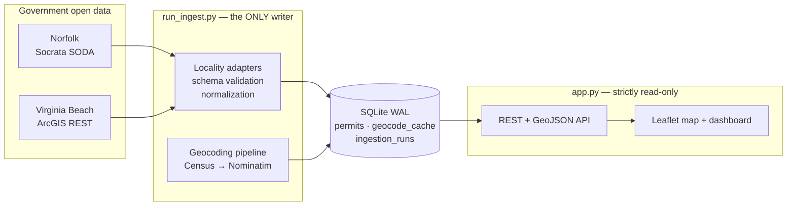
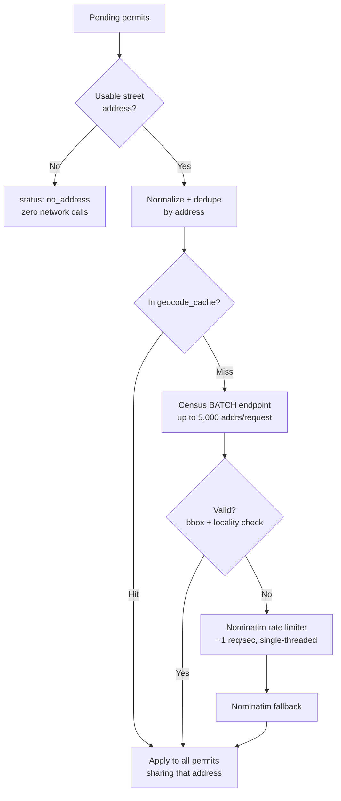

<p align="center">
  
</p>

**A building-permit intelligence platform for Hampton Roads, Virginia — built on real government open data, with a hard rule against fabricating anything.**

PermitIQ pulls building and development permit records directly from each city's own open-data system, normalizes wildly different schemas into one, geocodes addresses that arrive without coordinates, and serves an interactive map + filterable dashboard over the result.

The interesting part isn't the CRUD. It's that **civic open data is messy in ways that punish naive implementations**: two cities publish the same concept under different field names, one stores dates as strings that silently break SQL date filters, a third exposes a service whose name matches what you want but whose contents are from a different *state*. This README documents both the system and the specific traps it was built to survive.

---

## At a glance

| | |
|---|---|
| **Live dataset** | 10,850 real permits — 3,882 Norfolk, 6,968 Virginia Beach |
| **Geocoded coverage** | **91.1%** (9,886 mapped) — every remaining record has an explicit, auditable reason |
| **Test suite** | **189 tests**, all passing, zero live network calls |
| **Stack** | Python · FastAPI · SQLite (WAL) · vanilla JS + Leaflet · no ORM, no build step |
| **Data sources** | Socrata SODA API (Norfolk) · ArcGIS REST (Virginia Beach) · US Census Geocoder · Nominatim |
| **Backlog geocoding** | ~6 minutes for 7,800 addresses (was ~3 hours before batch rearchitecture) |

---

## Why this is harder than it looks

Three real problems, each of which would have silently corrupted the dataset if handled naively:

**1. A correctly-named service containing the wrong state's data.**
Planning documentation pointed at an ArcGIS FeatureServer literally named `Building_Permits_Pending` for Portsmouth, VA. It returns individual permit records with point geometry — exactly the right *shape*. Querying its distinct `countylocation` values live returned `DURH` and `WAKE`: Durham and Wake Counties, **North Carolina**. It's a generic multi-tenant hosted layer that happens to share a name. Building against it would have put hundreds of North Carolina permits on a Virginia map with total confidence.

**2. Date fields that aren't dates.**
Every field in Virginia Beach's feature layer — including `ApplicationDate`, `IssueDate`, `FinalDate` — is typed `esriFieldTypeString`. A standard `WHERE ApplicationDate >= DATE '2024-01-01'` predicate doesn't error against a string column; it *silently mismatches* and returns unfiltered-looking results from the wrong year. An incremental sync built on that would appear to succeed forever while quietly ignoring its own date window.

**3. Status vocabularies that don't overlap.**
Norfolk publishes 25+ distinct raw status values (`C/O Issued`, `Additional Information Required`, `Portal Submitted`, `Reviews in progress`…). Virginia Beach publishes 11 completely different ones (`Pre-Issuance`, `Pending Revisions`, `Ready to Issue`…). Neither is a subset of the other, and the same English word can mean different things in different jurisdictions.

The response to all three is the same principle, applied throughout: **verify against the live source before writing code, and never let an unknown value become a confident-looking guess.**

---

## Architecture



**The load-bearing constraint: ingestion and serving never share a process.**

`app.py` exposes no `POST`/`PUT`/`PATCH`/`DELETE` on permits, never imports `run_ingest.py`, and has no route that triggers a sync. Writes happen exclusively through a CLI you run by hand or on a schedule.

This isn't stylistic. A sibling project of mine hit an out-of-memory kill in production because a data-loading subprocess was spawned from a running web server's request path. The separation here is enforced structurally — there is no code path from an HTTP request to a write — so the failure mode is impossible rather than merely avoided.

### Repository layout

```
app.py                  Read-only FastAPI app (8 routes)
db.py                   Schema, WAL connection helper, schema versioning
run_ingest.py           CLI — the only process that writes permit data
ingest/
  common.py             NormalizedPermit, retry/backoff, coordinate-precedence upsert
  geocode.py            Census/Nominatim pipeline, rate limiter, batch geocoding
  norfolk.py            Socrata adapter
  virginia_beach.py     ArcGIS adapter
scripts/
  geocode_backlog.py    Batch-first backlog runner with full observability
  backfill_status_bucket.py   Recompute derived values after a mapping change
static/                 index.html · app.js · style.css (no build step)
tests/                  189 tests, fixture-based
```

---

## Engineering decisions worth explaining

### Coordinate precedence, not `COALESCE`

Permits arrive from multiple provenance tiers: some sources carry native geometry, most need geocoding, and a human might one day correct a bad pin. The naive upsert is `COALESCE(existing.lat, incoming.lat)` — keep what you have.

That's wrong in both directions. It permanently locks in the *first* coordinate ever written (including a bad low-confidence geocode), and it blocks a genuinely better source from ever taking over.

The upsert implements an explicit precedence ladder — **manual > native > Census > Nominatim > missing** — tracked in a `coordinate_source` column. A re-ingest can upgrade a Nominatim guess to native geometry, but can never downgrade, and never touches a manual correction. This is enforced in SQL via a registered `coord_rank()` function so the logic lives in exactly one place.

### Schema-drift detection at batch level, not per record

Adapters declare `REQUIRED_FIELDS` and validate the live response before processing. The subtlety: **Socrata omits null-valued keys per row**, so checking each record individually would false-positive constantly on legitimately-empty fields.

The check runs against the *union* of keys across a page. A field missing from one record is normal; a field missing from every record in a non-empty page means the upstream schema changed, and ingestion fails loudly instead of quietly writing degraded rows.

A related ordering bug surfaced during testing: the drift check originally ran *before* the empty-page check, so a legitimately-empty result (no permits in a given date window) was misdiagnosed as "every required field vanished." Caught by a test that asserted on the date-filter parameter and failed for an unrelated reason.

### Provider-aware geocoding (a ~30× speedup)

Nominatim's usage policy allows roughly one request per second. The original implementation applied that pacing after **every** geocoding attempt.

Inspecting the live cache showed why that was expensive: **Census resolved 97% of successful geocodes.** The system was paying Nominatim's rate limit on thousands of calls that never touched Nominatim.

The rearchitected pipeline:



Three compounding wins: **deduplication** (many permits share an address), **cache reuse** (7,028 memoized addresses), and **Census batch geocoding** (thousands of addresses per HTTP request instead of one).

The rate limiter itself tracks elapsed time against a monotonic clock rather than blindly sleeping, so calls already naturally spaced by other work don't oversleep. It's injected as a dependency, which lets the test suite verify real pacing behaviour with a fake clock — **no test sleeps for a real second**.

Result: a 200-permit batch went from ~350s to **11.4s**. The full 7,800-address backlog completes in about 6 minutes instead of an estimated 3 hours.

Nominatim remains deliberately conservative — single-threaded, one process, identifying User-Agent, every result cached, no retry storms, no parallel fan-out. Speed came from *not calling it unnecessarily*, not from leaning on it harder.

### Every unmapped record has a reason

Chasing a coverage percentage creates pressure to fabricate. PermitIQ classifies instead, and the categories sum exactly to the row count:

| `geocode_status` | Count | Meaning |
|---|---:|---|
| `matched` | 9,886 | Geocoded and validated |
| `no_address` | 830 | Source record has no street address at all |
| `not_found` | 132 | Real address, geocoder couldn't resolve it |
| `rejected_outside_area` | 2 | Resolved outside the Hampton Roads bounding box |
| **Total** | **10,850** | |

`no_address` is a real category, not missing data. Virginia Beach issues utility permits with values like `"Verizon - Poles 104"` in the address field — there is no location to resolve. These are detected by shape *before* any network call, so they cost nothing and are reported honestly rather than counted as failures.

Finding this distinction exposed a genuine bug: permits with `address = NULL` were excluded by the query's `WHERE` clause *before* reaching classification, leaving 829 real records stuck in `pending` forever — invisible, never retried, never explained. The filter was removed so those rows reach the `no_address` branch instead.

### Derived values need a backfill path

`status_bucket` (the 5-value normalized enum powering map colors and filters) is computed at ingest time and stored, not derived at read time — a deliberate choice for query performance.

The consequence: expanding a status mapping only affects *future* ingests. When Norfolk's mapping grew from 6 entries to 26 after observing real production values, 1,030 already-stored rows were still bucketed as `other`.

`scripts/backfill_status_bucket.py` recomputes stored values against the current mapping — dry-run by default, values-only, no schema change. It reported the exact 1,030 rows and their before→after transitions for review before anything was written.

### Security and correctness in the read layer

- **Sort injection.** SQLite can't parameterize column or direction identifiers, so `?sort=` was a genuine injection surface. Both the column and the direction are validated against fixed allowlists before ever reaching the SQL string. `?sort=id;DROP TABLE permits;--` returns `422`, and the table is verifiably intact afterward.
- **Every filter is parameterized.** A search for `' OR '1'='1` is treated as a literal string and matches zero rows.
- **`raw_json` is never exposed.** Each source's complete original record is stored for auditability, but the API's returned-field list is an explicit allowlist — not a filter applied after the fact — so there's no refactor that can accidentally leak it.
- **Output escaping.** Every externally-sourced string is escaped before insertion into the DOM. Verified by running an `` payload through the actual render path, not just the helper in isolation.
- **Stable pagination.** Default ordering is `COALESCE(issued_date, applied_date) DESC, id DESC` — the `id` tiebreaker prevents records shuffling between pages when timestamps collide.

### Idempotency, proven rather than assumed

Ingestion uses `UNIQUE(locality, source_permit_id)` with an upsert, and distinguishes *inserted* / *updated* / *unchanged* / *skipped* — a no-op conflict is never miscounted as an update.

This was verified by running the identical ingest command twice against live sources: **0 duplicate key pairs across 10,850 rows, 0 inserts on the second run, 0 false updates, and all 297 existing coordinates preserved byte-for-byte.**

The second run also surfaced something real: Norfolk's skip count changed between runs. Investigation (rather than assumption) showed the live feed itself had shifted within the ~15-minute gap, producing genuine in-batch duplicate permit numbers. Source behaviour, not an application bug — and the dedup logic handled it correctly.

### Observability that distinguishes failure modes

An `ingestion_runs` table records every sync with success/failure status and counts. Without it, a silently-broken ingest is indistinguishable from "no new permits this week." `/api/data-status` reads from it directly rather than inferring health from row counts.

The backlog runner reports cache hits, unique addresses sent to Census, Census matched/rejected/not-found, Nominatim attempted/matched/not-found, no-address, errors, coverage before and after, and remaining backlog — **per locality**. Provider failures are never collapsed into one vague "failed" number when the reason is known.

---

## Running it

```powershell
python -m venv .venv
.venv\Scripts\activate
pip install -r requirements.txt

python scripts/migrate_db.py      # create / migrate the schema (the API never does)
python -m uvicorn app:app --port 8090
```

Open `http://localhost:8090`. The database starts **empty** — PermitIQ ships no seed data, because fabricated sample rows in a civic-data tool are exactly the failure this project is built to avoid.

### Populating data

```powershell
# Inspect what would be fetched, write nothing
python run_ingest.py --locality norfolk --limit 20 --dry-run

# Real ingest — a ~90-day window finishes fast; the 2-year default takes longer
python run_ingest.py --locality all --since 2026-04-24

# Work the geocoding backlog without re-fetching from source (batch-first, fast)
python scripts/geocode_backlog.py --locality all --analyze
```

`--locality` accepts `norfolk`, `virginia_beach`, or `all`. Re-running is always safe. `--analyze` prints the unmapped-reason breakdown.

### Flood exposure (Virginia Beach, FEMA NFHL)

The API is read-only: it opens SQLite with `mode=ro`, never creates or migrates schema, and answers **503** with a hint until `scripts/migrate_db.py` has run. Flood data is loaded and tagged by CLI writers, in this order:

```powershell
python scripts/migrate_db.py                 # schema v2: flood tables + permit_flood_effective view
python scripts/profile_vb_fields.py          # observed PermitType / WorkType / ConstructionType values
#   -> fill [cohort].include in config/flood_report.toml from that output (ships empty on purpose)
python scripts/load_flood_zones.py --dry-run # FEMA NFHL layer 28, DFIRM 51810C: feature count, zone mix, cell sizes
python scripts/load_flood_zones.py
python scripts/tag_flood_zones.py --dry-run  # before -> after class transitions
python scripts/tag_flood_zones.py
python scripts/flood_report.py               # reports/flood_exposure_vb.md + .csv
```

- **Classes:** `sfha_v` (VE/V), `sfha_a` (AE/A*), `shaded_x` (0.2% annual chance), `matched_non_sfha`, `no_polygon` (geocoded but no FEMA polygon matched — a possible coverage gap, **never** reported as "outside"), `not_geocoded`; derived at read time: `untagged`, `out_of_scope` (localities without a DFIRM, i.e. Norfolk). Overlaps resolve VE/V > AE > other A > shaded X > other; a point on a boundary is inside.
- **Revisions:** each load is a `flood_zone_loads` row identified by a content hash, not FEMA's vintage label. One active load per DFIRM is enforced by a partial unique index. A tag is current only if it was made against the active load at the permit's current coordinates — defined once in the `permit_flood_effective` view, which every read and the tagger use. Stale tags read as `untagged` with no zone details.
- **Map layer:** the loader pre-builds 0.05° grid cells (SFHA + shaded X only), each under a hard 2 MB limit after progressive simplification; a load with an oversized cell is stored inactive and the previous load keeps serving. Cells are served as stored bytes with an ETag (304 on `If-None-Match`).
- **Report definitions:** population = issued, non-void VB permits; cohort = the explicit allowlist in `config/flood_report.toml`; baseline = all issued permits. Shares use matched permits only as the denominator; `no_polygon`, `not_geocoded` and `untagged` are shown beside every row as counts. Shares are suppressed below `min_n` (20). Only context filters (`issued_from`, `issued_to`, `zip`) apply, to cohort and baseline alike. `/api/flood-stats` and `flood_report.py` share one implementation (`ingest/flood_stats.py`).
- **Caveats:** address point ≠ building footprint; effective FIRM only; issued ≠ built; SFHA ≠ full flood risk.

### Land-use approvals → permits (Virginia Beach, Stage 2)

Links City Council land-use decisions (from a read-only VoteIQ export) to later building permits at the same property. It answers three questions: which approvals have no permit yet, how long approval-to-permit takes, and what flood class each approval falls in.

```powershell
# on the VoteIQ host -- read-only, standalone, changes nothing in VoteIQ
python tools/export_vb_council_votes.py /var/data/polls.db > vb_council_votes.jsonl 2> vb_schema.txt

python scripts/profile_land_use_export.py --file vb_council_votes.jsonl
#   -> fill config/land_use.toml from that output (ships empty on purpose)
python scripts/migrate_db.py                                      # schema v3
python scripts/ingest_land_use_decisions.py --file vb_council_votes.jsonl --dry-run
python scripts/ingest_land_use_decisions.py --file vb_council_votes.jsonl
python scripts/ingest_land_use_decisions.py --geocode
#   -> set [coverage] backfill_from + backfill_run_id to the VB backfill you actually ran
python scripts/link_decisions_permits.py --dry-run
python scripts/link_decisions_permits.py
python scripts/review_land_use.py --outcomes reports/land_use_review.csv   # after filling it in
python scripts/review_land_use.py --links reports/link_review.csv          # after filling it in
python scripts/tag_flood_zones.py --decisions
python scripts/land_use_report.py                                 # reports/land_use_vb.md + CSVs
```

- **Approval is never inferred.** "Vote Complete" with more yes than no votes could be a motion to deny or defer. Vote counts and the result string are stored only as evidence. A decision is approved only through `review_land_use.py --outcomes`, which requires evidence: the minutes, the IQM2 item, or the verbatim motion. Until that review is done, the lead list is empty.
- **Source conflicts are quarantined.** If member rows for one item disagree on title, result or date, nothing is picked. Every variant is kept, and review must resolve the conflict.
- **Coverage is verified.** The observation window starts at a named VB backfill run, checked against `ingestion_runs`, never at the oldest permit on file. It ends at the latest successful refresh. If either end is uncertain (approval before the backfill, no refresh, or a refresh older than 14 days), the status is `observation_uncertain`, never "no permit yet".
- **Links are candidates.** Matching uses a printed GPIN (first 10 digits), an exact house number and street, or a printed house-number range. A property match may not belong to the approved project, so only `review_land_use.py --links` confirms a link. Nearby addresses go to the review file and are never linked automatically.
- **Time to permit** has three measures: first permit application, first issued permit, and first new-construction application. Each counts once per decision (its earliest permit) and is reported twice: confirmed links (the headline) and including candidates. The report shows the median and IQR (nearest-rank); open decisions are counted but never imputed.
- **Exports are checked.** The exporter writes its row count in the same read snapshot as the rows. The ingest and the profile refuse any file whose header is missing or whose row count does not match, so a truncated export can't ingest as complete.
- **Reviews expire when their facts change.** Each review stores a fingerprint of the title, result, meeting date and source conflicts it was made on. If a re-ingest changes any of these, the decision becomes `outcome_review_stale` and needs a fresh review. The old review is kept for audit. The v4 migration computes fingerprints for existing decisions, and reviews made before v4 also count as stale.
- **One window rule.** A link counts only if the permit was applied for on or after the approval and within `link_window_months`, using SQLite `date()` arithmetic everywhere. The review import refuses confirmed links outside the window, and the linker drops them. Every read goes through the `decision_permit_links_effective` view: status, link counts, timing, the flood fallback, the API, and the ingest's geocode skip.
- Status is defined once, in the `land_use_decision_status` view.

### Parcel enrichment (Virginia Beach, Stage 3)

Matches permits and Council decisions to city parcels (`Property_Information/MapServer/12`). It adds zoning, land use, property class and acreage, and classifies flood exposure by the **parcel polygon** next to the Stage 1 address point. Parcel flood classes are a **screening estimate**: the city's parcel terms say the data is "not valid for … flood-zone determination".

```powershell
python scripts/migrate_db.py                       # schema v5
python scripts/load_parcels.py --inspect           # fields, maxRecordCount, lastEditDate, returnCountOnly
python scripts/inspect_pc_actions_layer.py --out p.json --compare-council  # Planning/Council Actions layer, read-only
python scripts/load_parcels.py --dry-run
python scripts/load_parcels.py                     # or: --file vb_parcels.geojson --expected-count N
python scripts/match_parcels.py --dry-run
python scripts/match_parcels.py
python scripts/review_parcels.py reports/parcel_review.csv   # after filling it in (disputed matches)
python scripts/tag_parcel_flood.py
python scripts/link_decisions_permits.py           # adds the same_parcel tier
python scripts/parcel_report.py                    # reports/parcel_vb.md + .csv
```

- **Complete loads only.** The loader reads the layer's count and the full list of object IDs, then fetches in batches of at most 2,000 by object ID. A load is activated only if the received IDs equal that list exactly (none missing, none duplicated, none extra) and the count hasn't changed during the fetch. Otherwise nothing is written and the previous load keeps serving. `--file` requires `--expected-count`.
- **Matching rules.**
  - Permits: an exact 14-digit GPIN; else a 10-digit GPIN that matches exactly one parcel; else the point inside exactly one parcel. Several candidates means `ambiguous`, never a guess.
  - Decisions: the printed GPIN, else the exact parcel address, else the geocoded point.
- **Disputes.** When a GPIN and a point land on different parcels, the match is **disputed**. It is shown with both parcels and excluded from `same_parcel` links and from the `gpin` link tier until `review_parcels.py` resolves it:
  - `gpin_correct` re-enables both;
  - `point_correct` switches the parcel to the point's;
  - `unresolvable` keeps the match excluded.
- **Review freshness.** A review records the facts it judged: GPIN, address, house-number range, point and parcel load. If any of those change, the review stops applying.
- **Parcel flood class.** The class is the most hazardous of V, A or shaded X covering at least `min_share` of the parcel (`config/parcels.toml`, default 1%).
  - `screening_sliver`: a hazard zone touches the parcel but none reaches the threshold.
  - `screening_partial_coverage`: part of the parcel has no FEMA polygon.
  - `matched_non_sfha`: only when the whole parcel is mapped outside the SFHA.
  - All five area shares are always shown.
  - `/api/flood-stats?basis=parcel` reports the parcel basis; screening, unmatched, ambiguous and disputed parcels are coverage classes and never enter a denominator.
- **Cross-check.** The report compares our parcel class with the city's own `FEMA_ZONE_BLDG` field.
- **No assessed values or lead score yet.** There is no assessor bulk source.

### Real-data run, measured accuracy, lead screen

One logged runbook runs the whole Virginia Beach chain on real data. The Council export comes from the VoteIQ host via `tools/export_vb_council_votes.py`.

```powershell
python scripts/run_vb_pipeline.py --phase profile --council-export vb_council_votes.jsonl
#   -> fill config/flood_report.toml and config/land_use.toml from the profile logs
python scripts/run_vb_pipeline.py --phase full --council-export vb_council_votes.jsonl `
    --parcels-file vb_parcels.geojson --parcels-count N --reviews-dir reviews\
#   -> check reports\run_*\accuracy_sample.csv (an independent search for each lead row)
python scripts/accuracy_tally.py reports\run_<ts>\accuracy_sample.csv --apply-links
python scripts/run_vb_pipeline.py --phase full ... --reviews-dir reviews\   # re-link + reports after reviews
```

- **Order.** Council decisions are ingested and geocoded before parcel matching, flood tagging and linking. Imported reviews trigger a re-link before any report.
- **Run manifest.** `reports/run_<ts>/run_manifest.json` records each step's command, exit code, times and output tail, the order executed, and the source dates.
- **Skipped steps.** A refused step (e.g. the cohort not configured yet) is recorded as skipped, with its reason.
- **Unmatched reasons.** `unmatched_reasons.csv` lists every entity per aspect that did not fully match, with its reason code; `unmatched_reasons_counts.csv` totals them.
- **Cross-row conflicts.** If a decision's street-address parcel is not among its printed-GPIN parcels, that is a cross-row conflict. Those rows feed no parcel or GPIN link until `review_parcels.py` records a decision-set verdict (`rows_consistent`, `gpin_rows_correct`, `street_rows_correct`, `unresolvable`). A multi-parcel application, with more GPINs than addresses, is not a conflict.
- **Stale reviews come first.** A review whose facts changed reads `outcome_review_stale` even when the item also has source conflicts; `has_conflicts` shows both.
- **Frozen accuracy samples** (`accuracy_sample.py`) record:
  - the source-load IDs and Council export SHA;
  - a content fingerprint of permits, decisions, links and reviews;
  - each stratum's population N, the seed and the selection rule;
  - per-row fact fingerprints and a sheet hash.
- **Judgments are explicit.** Links use `same_project`. Leads use `lead_check` plus a required `search_done`, an independent search outside `permits.db`. Flood disagreements use `flood_check`.
- **The tally** (`accuracy_tally.py`):
  - refuses an edited sheet;
  - drops rows whose facts changed;
  - reports per-tier adjudicated-sample precision with Wilson 95% intervals, beside N, `cant_tell` and the stale count;
  - gives a pooled figure only as a labeled population-weighted estimate, when every tier was adjudicated;
  - with `--apply-links`, turns only fresh `same_project` yes/no link rows into link reviews.
- **`/api/quality` and `quality_report.py`** show live coverage, unresolved cases and refresh age. Accuracy is withheld (`"freshness": "stale"`) whenever the data it was computed on has changed. A re-run that changes nothing keeps the tally fresh.
- **Locality acceptance checklist and run record.** The quality report opens with the standard a locality must meet. Each line is pass, fail or "not yet", filled from the report's own numbers: backfill verified, source dates, official cross-check, outcome reviews, link tiers / leads / flood disagreements checked to min(30, N), unresolved cases, and no failed or gap steps. Every non-ok step from `run_manifest.json`, plus source row counts, is listed beneath it. "Not yet" is never a pass.
- **Lead screen.** `/static/lead.html?key=<decision_key>` (also "Open lead details" in the map popup) shows on one screen:
  - the Council decision with its review evidence;
  - the parcel(s) with dispute state and an outline;
  - later permits with match reason and review state;
  - flood screening;
  - data as of.
- **Marking links.** "Mark bad link" / "Confirm" queue verdicts in the browser, and "Download review file" saves a CSV for `review_land_use.py --links`. The API stays read-only.
- **Lead summary** (`ingest/lead_facts.py`), on the lead screen, in `GET /api/land-use/decisions/{key}` as `lead_facts`, and as extra columns in `land_use_leads.csv`:
  - **Applicant, request and size** (acres, units, lots, square feet) are extracted from the Council title and shown with the exact text they came from, labeled unverified.
  - **Applicant names** are shown only when every listed applicant is an organization (LLC, Inc, Corp…); otherwise the name is withheld. Trusts count as individuals, because they are often named after a person.
  - **Parcel acreage** comes from the parcel layer and is shown separately.
  - **Timing, for verified approvals only:**
    - days from approval to the last permit refresh;
    - the end of the link window;
    - a benchmark range for the first permit application, from confirmed links only, over all verified approvals. It is suppressed below `min_n`.
  - **"Older than the typical range"** is flagged when no permit has been observed and the lead is past that range. Extracted values never affect status, links or approval.
- **Backfill completeness.** `verify_permit_backfill.py --since …` compares the source's own count and OBJECTID set for the same `ApplicationDate` window with the database.
  - Truly missing permits are fetched by ID and topped up. Duplicate permit numbers, rows without a permit number, and rows with no application date are reported.
  - Counts by application year are listed side by side.
  - The linker accepts a backfill run only with a verified check.
- **Stages.** `--stage provisional` (the default) marks reports and lead files provisional and draws no accuracy sample. `--stage final` refuses without outcome reviews, or with stale ones, and draws the sample from the reviewed snapshot.
- **Report-only phase.** `--phase report` regenerates reports only, keeping the sample's recorded N beside today's counts.
- **Hand-off.** `handoff_extract.py` builds a hand-off folder: the run, a database inventory with its SHA-256, and CSV extracts without `raw_json`. The database file itself is not included.
- **Review history (schema v8).** Database triggers record every change to a human review in `review_audit`: outcomes, link verdicts, parcel verdicts and decision-set verdicts.
  - **Each change is tied to its import** in `review_imports`: the CSV file and its SHA-256, and the acting user (`--actor`, or the OS user).
  - **Accuracy imports** (`accuracy_tally.py --apply-links`) record the checked sample sheet as the source. The generated verdict CSV is recorded as a derived file.
  - **Writes outside an import are refused.** Review writes are allowed only inside `db.review_import()`, one transaction with the provenance. `review_audit` and `review_imports` refuse `UPDATE`, `DELETE` and `INSERT OR REPLACE` onto existing rows.
  - **Existing reviews** get one `baseline_snapshot` at migration, with no provenance: earlier changes were never recorded.
  - **Each history entry** names the review's author separately from the person who ran the import.
  - **Limits:** this is not authenticated and not tamper-proof. The acting user is self-reported, and anyone who can write the database file can alter it.
  - **Where to see it:** `GET /api/audit/{review_table}` with exactly that table's key, and "Review history" on the lead screen.

---

## API

Read-only. No mutation routes exist on `/api/permits*`.

| Route | Purpose |
|---|---|
| `GET /health` | Liveness + schema check |
| `GET /api/permits` | Filter, search, sort, paginate |
| `GET /api/permits/{id}` | Single record |
| `GET /api/facets` | Locality availability + observed types/statuses (dynamic) |
| `GET /api/stats` | Totals, mapped/unmapped, geocode + status breakdowns |
| `GET /api/data-status` | Per-locality sync history from `ingestion_runs` |
| `GET /api/export.geojson` | GeoJSON of mapped permits (capped; errors rather than truncating) |
| `GET /api/export.csv` | Same filters, all permits incl. unmapped, with flood fields — Power BI-ready |
| `GET /api/flood-stats` | Flood-exposure shares: cohort vs baseline, by year and ZIP (context filters only; population filters ⇒ 422) |
| `GET /api/flood-zones/index.json` | Active flood load's display cells (bbox, bytes, etag) |
| `GET /api/flood-zones/{x}/{y}.geojson` | One display cell (ETag / 304; 413 over the size limit) |
| `GET /api/land-use/decisions` | Council land-use decisions with status, links and flood class (filters: `status`, `outcome`, `land_use_label`, `flood_class`, `decided_from/to`, `match_tier`) |
| `GET /api/land-use/decisions/{key}` | One decision: addresses, linked permits with tier and state, conflicts, review |
| `GET /api/land-use/export.csv` | Same filters; the lead list is `?status=no_candidate_permit`; every row carries the permit observation window |
| `GET /api/land-use/stats` | Counts by status, label and year; time-to-permit blocks |
| `GET /api/parcels/{gpin}.geojson` | One parcel outline from the active parcel load (ETag / 304; 404 if absent) |
| `GET /api/quality` | Coverage, unresolved cases, refresh age; accuracy only while its data snapshot is current |
| `GET /api/data-as-of` | Recorded source dates and the permit observation window |
| `GET /api/audit/{review_table}` | Change history of one review; query parameters are exactly the table's key (e.g. `decision_link_review?decision_key=…&permit_id=…`); 400 otherwise |

Filters: `locality`, `permit_type`, `status`, `status_bucket`, `flood_class` (comma list or repeated; each value validated), `q`, `issued_from`, `issued_to`, `sort`, `order`, `limit`, `offset`.

---

## Tests

```powershell
python -m pytest tests/ -v
```

**430 tests**, run by CI (`.github/workflows/ci.yml`) on every push and PR, together with a scan for `.env` files and keys. No live network calls — fixtures are sanitized captures of real responses. Sleeps and clocks are injected, so rate-limiter behaviour is verified deterministically without the suite ever waiting a real second (full run: ~20s).

Coverage includes date/schema normalization, ArcGIS epoch conversion, coordinate-precedence rules, both adapters, geocoding (bbox and locality validation, cache reuse, retry gating, `no_address` classification, batch result mapping, resumability), and the full API surface (SQL-injection safety, pagination stability, export caps, `raw_json` non-exposure).

---

## Coverage and honest limitations

| Locality | Status |
|---|---|
| **Norfolk** | Live — Socrata SODA API, updated daily |
| **Virginia Beach** | Live — ArcGIS REST feature layer |
| Chesapeake | Source under review — permit system exists, no verified point-level open dataset found |
| Portsmouth | Source under review — see the North Carolina lookalike above |
| Hampton · Suffolk · Newport News | Unavailable — no confirmed open dataset located |

**Unsupported localities are shown in the UI, greyed out with an explanatory tooltip — not silently omitted.** A user who doesn't see Suffolk permits should learn that Suffolk isn't covered, not conclude Suffolk issues no permits.

Other limitations stated plainly:

- The original agency record is always authoritative. PermitIQ republishes; it doesn't adjudicate.
- 8.9% of permits have no map pin, each with a specific published reason (table above). **Missing data never implies no permit exists.**
- `valuation` is null for effectively all records — neither source exposes a genuine project-cost field. Norfolk's `total_balance` is a *fee* balance and is deliberately not mapped to it.
- Permit type and status vocabularies are per-city and are not harmonized beyond the coarse `status_bucket` enum.

---

## What I'd build next

- **Chesapeake / Portsmouth adapters** — blocked on source discovery, not implementation. The adapter interface is a single `fetch(since, limit)` generator; adding a verified locality is a contained change.
- **Address normalization pass** for the 132 `not_found` records — several are formatting artifacts (`"1234 Gwaltney Way : -"`) that a cleanup step would likely resolve.
- **Split `skipped_count`** in `ingestion_runs` into `skipped_duplicate` vs `skipped_invalid` — currently one aggregate where the distinction is already known at runtime.
- **Scheduled ingestion** via Task Scheduler/cron, keeping the strict no-HTTP-triggered-writes rule intact.

---

## Verification note

Every phase of this project was verified against the **live** government APIs and the real accumulating database — not mocked and not assumed. The specific bugs described above (the North Carolina lookalike, the string-typed date fields, the `NULL`-address records stuck pending, the 1,030 mis-bucketed statuses) were all found that way, several of them only *after* the code appeared to be working correctly.
