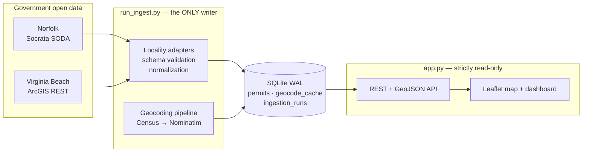
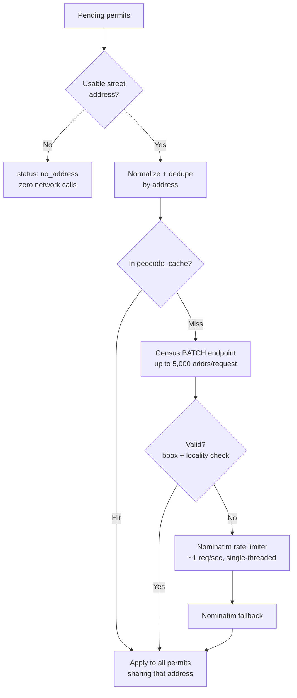

# PermitIQ

**A building-permit intelligence platform for Hampton Roads, Virginia — built on real government open data, with a hard rule against fabricating anything.**

PermitIQ pulls building and development permit records directly from each city's own open-data system, normalizes wildly different schemas into one, geocodes addresses that arrive without coordinates, and serves an interactive map + filterable dashboard over the result.

The interesting part isn't the CRUD. It's that **civic open data is messy in ways that punish naive implementations**: two cities publish the same concept under different field names, one stores dates as strings that silently break SQL date filters, a third exposes a service whose name matches what you want but whose contents are from a different *state*. This README documents both the system and the specific traps it was built to survive.

---

## At a glance

| | |
|---|---|
| **Live dataset** | 10,850 real permits — 3,882 Norfolk, 6,968 Virginia Beach |
| **Geocoded coverage** | **91.1%** (9,886 mapped) — every remaining record has an explicit, auditable reason |
| **Test suite** | **189 tests**, all passing, zero live network calls |
| **Stack** | Python · FastAPI · SQLite (WAL) · vanilla JS + Leaflet · no ORM, no build step |
| **Data sources** | Socrata SODA API (Norfolk) · ArcGIS REST (Virginia Beach) · US Census Geocoder · Nominatim |
| **Backlog geocoding** | ~6 minutes for 7,800 addresses (was ~3 hours before batch rearchitecture) |

---

## Why this is harder than it looks

Three real problems, each of which would have silently corrupted the dataset if handled naively:

**1. A correctly-named service containing the wrong state's data.**
Planning documentation pointed at an ArcGIS FeatureServer literally named `Building_Permits_Pending` for Portsmouth, VA. It returns individual permit records with point geometry — exactly the right *shape*. Querying its distinct `countylocation` values live returned `DURH` and `WAKE`: Durham and Wake Counties, **North Carolina**. It's a generic multi-tenant hosted layer that happens to share a name. Building against it would have put hundreds of North Carolina permits on a Virginia map with total confidence.

**2. Date fields that aren't dates.**
Every field in Virginia Beach's feature layer — including `ApplicationDate`, `IssueDate`, `FinalDate` — is typed `esriFieldTypeString`. A standard `WHERE ApplicationDate >= DATE '2024-01-01'` predicate doesn't error against a string column; it *silently mismatches* and returns unfiltered-looking results from the wrong year. An incremental sync built on that would appear to succeed forever while quietly ignoring its own date window.

**3. Status vocabularies that don't overlap.**
Norfolk publishes 25+ distinct raw status values (`C/O Issued`, `Additional Information Required`, `Portal Submitted`, `Reviews in progress`…). Virginia Beach publishes 11 completely different ones (`Pre-Issuance`, `Pending Revisions`, `Ready to Issue`…). Neither is a subset of the other, and the same English word can mean different things in different jurisdictions.

The response to all three is the same principle, applied throughout: **verify against the live source before writing code, and never let an unknown value become a confident-looking guess.**

---

## Architecture



**The load-bearing constraint: ingestion and serving never share a process.**

`app.py` exposes no `POST`/`PUT`/`PATCH`/`DELETE` on permits, never imports `run_ingest.py`, and has no route that triggers a sync. Writes happen exclusively through a CLI you run by hand or on a schedule.

This isn't stylistic. A sibling project of mine hit an out-of-memory kill in production because a data-loading subprocess was spawned from a running web server's request path. The separation here is enforced structurally — there is no code path from an HTTP request to a write — so the failure mode is impossible rather than merely avoided.

### Repository layout

```
app.py                  Read-only FastAPI app (8 routes)
db.py                   Schema, WAL connection helper, schema versioning
run_ingest.py           CLI — the only process that writes permit data
ingest/
  common.py             NormalizedPermit, retry/backoff, coordinate-precedence upsert
  geocode.py            Census/Nominatim pipeline, rate limiter, batch geocoding
  norfolk.py            Socrata adapter
  virginia_beach.py     ArcGIS adapter
scripts/
  geocode_backlog.py    Batch-first backlog runner with full observability
  backfill_status_bucket.py   Recompute derived values after a mapping change
static/                 index.html · app.js · style.css (no build step)
tests/                  189 tests, fixture-based
```

---

## Engineering decisions worth explaining

### Coordinate precedence, not `COALESCE`

Permits arrive from multiple provenance tiers: some sources carry native geometry, most need geocoding, and a human might one day correct a bad pin. The naive upsert is `COALESCE(existing.lat, incoming.lat)` — keep what you have.

That's wrong in both directions. It permanently locks in the *first* coordinate ever written (including a bad low-confidence geocode), and it blocks a genuinely better source from ever taking over.

The upsert implements an explicit precedence ladder — **manual > native > Census > Nominatim > missing** — tracked in a `coordinate_source` column. A re-ingest can upgrade a Nominatim guess to native geometry, but can never downgrade, and never touches a manual correction. This is enforced in SQL via a registered `coord_rank()` function so the logic lives in exactly one place.

### Schema-drift detection at batch level, not per record

Adapters declare `REQUIRED_FIELDS` and validate the live response before processing. The subtlety: **Socrata omits null-valued keys per row**, so checking each record individually would false-positive constantly on legitimately-empty fields.

The check runs against the *union* of keys across a page. A field missing from one record is normal; a field missing from every record in a non-empty page means the upstream schema changed, and ingestion fails loudly instead of quietly writing degraded rows.

A related ordering bug surfaced during testing: the drift check originally ran *before* the empty-page check, so a legitimately-empty result (no permits in a given date window) was misdiagnosed as "every required field vanished." Caught by a test that asserted on the date-filter parameter and failed for an unrelated reason.

### Provider-aware geocoding (a ~30× speedup)

Nominatim's usage policy allows roughly one request per second. The original implementation applied that pacing after **every** geocoding attempt.

Inspecting the live cache showed why that was expensive: **Census resolved 97% of successful geocodes.** The system was paying Nominatim's rate limit on thousands of calls that never touched Nominatim.

The rearchitected pipeline:



Three compounding wins: **deduplication** (many permits share an address), **cache reuse** (7,028 memoized addresses), and **Census batch geocoding** (thousands of addresses per HTTP request instead of one).

The rate limiter itself tracks elapsed time against a monotonic clock rather than blindly sleeping, so calls already naturally spaced by other work don't oversleep. It's injected as a dependency, which lets the test suite verify real pacing behaviour with a fake clock — **no test sleeps for a real second**.

Result: a 200-permit batch went from ~350s to **11.4s**. The full 7,800-address backlog completes in about 6 minutes instead of an estimated 3 hours.

Nominatim remains deliberately conservative — single-threaded, one process, identifying User-Agent, every result cached, no retry storms, no parallel fan-out. Speed came from *not calling it unnecessarily*, not from leaning on it harder.

### Every unmapped record has a reason

Chasing a coverage percentage creates pressure to fabricate. PermitIQ classifies instead, and the categories sum exactly to the row count:

| `geocode_status` | Count | Meaning |
|---|---:|---|
| `matched` | 9,886 | Geocoded and validated |
| `no_address` | 830 | Source record has no street address at all |
| `not_found` | 132 | Real address, geocoder couldn't resolve it |
| `rejected_outside_area` | 2 | Resolved outside the Hampton Roads bounding box |
| **Total** | **10,850** | |

`no_address` is a real category, not missing data. Virginia Beach issues utility permits with values like `"Verizon - Poles 104"` in the address field — there is no location to resolve. These are detected by shape *before* any network call, so they cost nothing and are reported honestly rather than counted as failures.

Finding this distinction exposed a genuine bug: permits with `address = NULL` were excluded by the query's `WHERE` clause *before* reaching classification, leaving 829 real records stuck in `pending` forever — invisible, never retried, never explained. The filter was removed so those rows reach the `no_address` branch instead.

### Derived values need a backfill path

`status_bucket` (the 5-value normalized enum powering map colors and filters) is computed at ingest time and stored, not derived at read time — a deliberate choice for query performance.

The consequence: expanding a status mapping only affects *future* ingests. When Norfolk's mapping grew from 6 entries to 26 after observing real production values, 1,030 already-stored rows were still bucketed as `other`.

`scripts/backfill_status_bucket.py` recomputes stored values against the current mapping — dry-run by default, values-only, no schema change. It reported the exact 1,030 rows and their before→after transitions for review before anything was written.

### Security and correctness in the read layer

- **Sort injection.** SQLite can't parameterize column or direction identifiers, so `?sort=` was a genuine injection surface. Both the column and the direction are validated against fixed allowlists before ever reaching the SQL string. `?sort=id;DROP TABLE permits;--` returns `422`, and the table is verifiably intact afterward.
- **Every filter is parameterized.** A search for `' OR '1'='1` is treated as a literal string and matches zero rows.
- **`raw_json` is never exposed.** Each source's complete original record is stored for auditability, but the API's returned-field list is an explicit allowlist — not a filter applied after the fact — so there's no refactor that can accidentally leak it.
- **Output escaping.** Every externally-sourced string is escaped before insertion into the DOM. Verified by running an `` payload through the actual render path, not just the helper in isolation.
- **Stable pagination.** Default ordering is `COALESCE(issued_date, applied_date) DESC, id DESC` — the `id` tiebreaker prevents records shuffling between pages when timestamps collide.

### Idempotency, proven rather than assumed

Ingestion uses `UNIQUE(locality, source_permit_id)` with an upsert, and distinguishes *inserted* / *updated* / *unchanged* / *skipped* — a no-op conflict is never miscounted as an update.

This was verified by running the identical ingest command twice against live sources: **0 duplicate key pairs across 10,850 rows, 0 inserts on the second run, 0 false updates, and all 297 existing coordinates preserved byte-for-byte.**

The second run also surfaced something real: Norfolk's skip count changed between runs. Investigation (rather than assumption) showed the live feed itself had shifted within the ~15-minute gap, producing genuine in-batch duplicate permit numbers. Source behaviour, not an application bug — and the dedup logic handled it correctly.

### Observability that distinguishes failure modes

An `ingestion_runs` table records every sync with success/failure status and counts. Without it, a silently-broken ingest is indistinguishable from "no new permits this week." `/api/data-status` reads from it directly rather than inferring health from row counts.

The backlog runner reports cache hits, unique addresses sent to Census, Census matched/rejected/not-found, Nominatim attempted/matched/not-found, no-address, errors, coverage before and after, and remaining backlog — **per locality**. Provider failures are never collapsed into one vague "failed" number when the reason is known.

---

## Running it

```powershell
python -m venv .venv
.venv\Scripts\activate
pip install -r requirements.txt

python -m uvicorn app:app --port 8090
```

Open `http://localhost:8090`. The database starts **empty** — PermitIQ ships no seed data, because fabricated sample rows in a civic-data tool are exactly the failure this project is built to avoid.

### Populating data

```powershell
# Inspect what would be fetched, write nothing
python run_ingest.py --locality norfolk --limit 20 --dry-run

# Real ingest — a ~90-day window finishes fast; the 2-year default takes longer
python run_ingest.py --locality all --since 2026-04-24

# Work the geocoding backlog without re-fetching from source (batch-first, fast)
python scripts/geocode_backlog.py --locality all --analyze
```

`--locality` accepts `norfolk`, `virginia_beach`, or `all`. Re-running is always safe. `--analyze` prints the unmapped-reason breakdown.

---

## API

Read-only. No mutation routes exist on `/api/permits*`.

| Route | Purpose |
|---|---|
| `GET /health` | Liveness + schema check |
| `GET /api/permits` | Filter, search, sort, paginate |
| `GET /api/permits/{id}` | Single record |
| `GET /api/facets` | Locality availability + observed types/statuses (dynamic) |
| `GET /api/stats` | Totals, mapped/unmapped, geocode + status breakdowns |
| `GET /api/data-status` | Per-locality sync history from `ingestion_runs` |
| `GET /api/export.geojson` | GeoJSON of mapped permits (capped; errors rather than truncating) |

Filters: `locality`, `permit_type`, `status`, `status_bucket`, `q`, `issued_from`, `issued_to`, `sort`, `order`, `limit`, `offset`.

---

## Tests

```powershell
python -m pytest tests/ -v
```

**189 tests.** No live network calls — fixtures are sanitized captures of real responses. Sleeps and clocks are injected, so rate-limiter behaviour is verified deterministically without the suite ever waiting a real second (full run: ~20s).

Coverage includes date/schema normalization, ArcGIS epoch conversion, coordinate-precedence rules, both adapters, geocoding (bbox and locality validation, cache reuse, retry gating, `no_address` classification, batch result mapping, resumability), and the full API surface (SQL-injection safety, pagination stability, export caps, `raw_json` non-exposure).

---

## Coverage and honest limitations

| Locality | Status |
|---|---|
| **Norfolk** | Live — Socrata SODA API, updated daily |
| **Virginia Beach** | Live — ArcGIS REST feature layer |
| Chesapeake | Source under review — permit system exists, no verified point-level open dataset found |
| Portsmouth | Source under review — see the North Carolina lookalike above |
| Hampton · Suffolk · Newport News | Unavailable — no confirmed open dataset located |

**Unsupported localities are shown in the UI, greyed out with an explanatory tooltip — not silently omitted.** A user who doesn't see Suffolk permits should learn that Suffolk isn't covered, not conclude Suffolk issues no permits.

Other limitations stated plainly:

- The original agency record is always authoritative. PermitIQ republishes; it doesn't adjudicate.
- 8.9% of permits have no map pin, each with a specific published reason (table above). **Missing data never implies no permit exists.**
- `valuation` is null for effectively all records — neither source exposes a genuine project-cost field. Norfolk's `total_balance` is a *fee* balance and is deliberately not mapped to it.
- Permit type and status vocabularies are per-city and are not harmonized beyond the coarse `status_bucket` enum.

---

## What I'd build next

- **Chesapeake / Portsmouth adapters** — blocked on source discovery, not implementation. The adapter interface is a single `fetch(since, limit)` generator; adding a verified locality is a contained change.
- **Address normalization pass** for the 132 `not_found` records — several are formatting artifacts (`"1234 Gwaltney Way : -"`) that a cleanup step would likely resolve.
- **Split `skipped_count`** in `ingestion_runs` into `skipped_duplicate` vs `skipped_invalid` — currently one aggregate where the distinction is already known at runtime.
- **Scheduled ingestion** via Task Scheduler/cron, keeping the strict no-HTTP-triggered-writes rule intact.

---

## Verification note

Every phase of this project was verified against the **live** government APIs and the real accumulating database — not mocked and not assumed. The specific bugs described above (the North Carolina lookalike, the string-typed date fields, the `NULL`-address records stuck pending, the 1,030 mis-bucketed statuses) were all found that way, several of them only *after* the code appeared to be working correctly.
